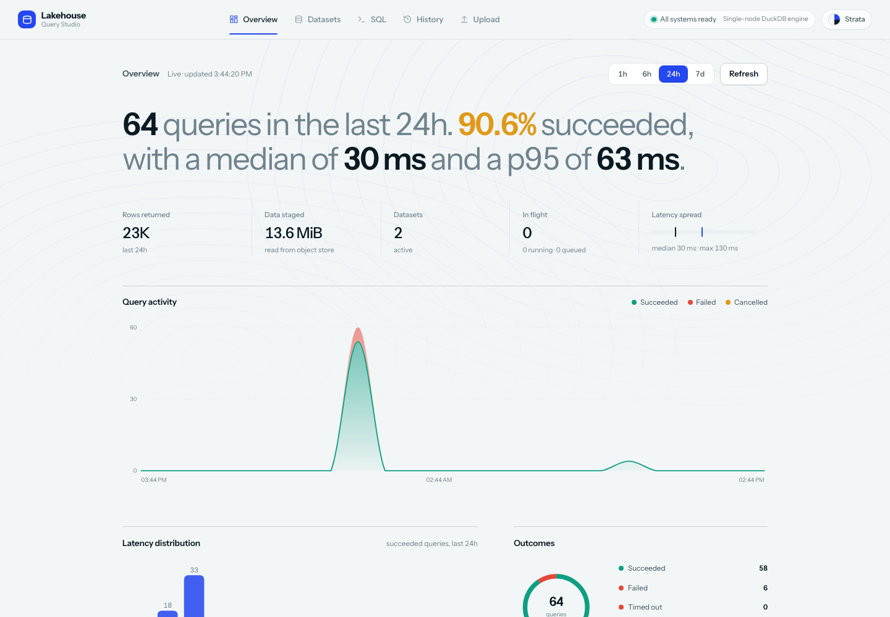
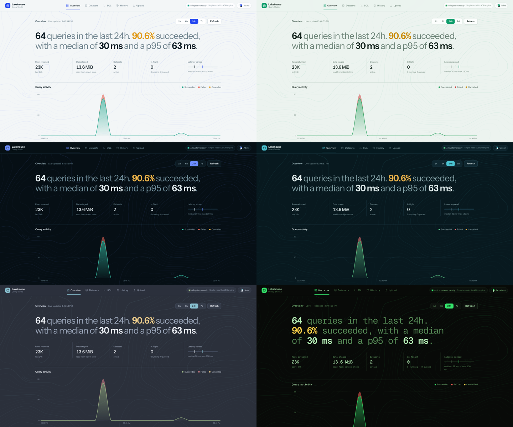
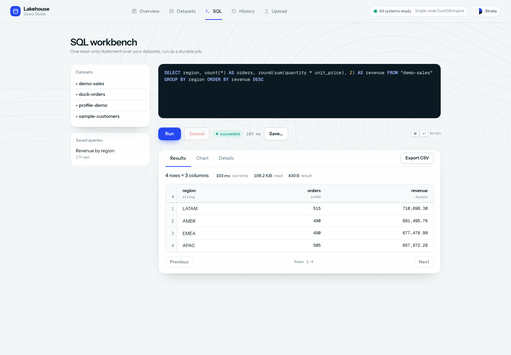
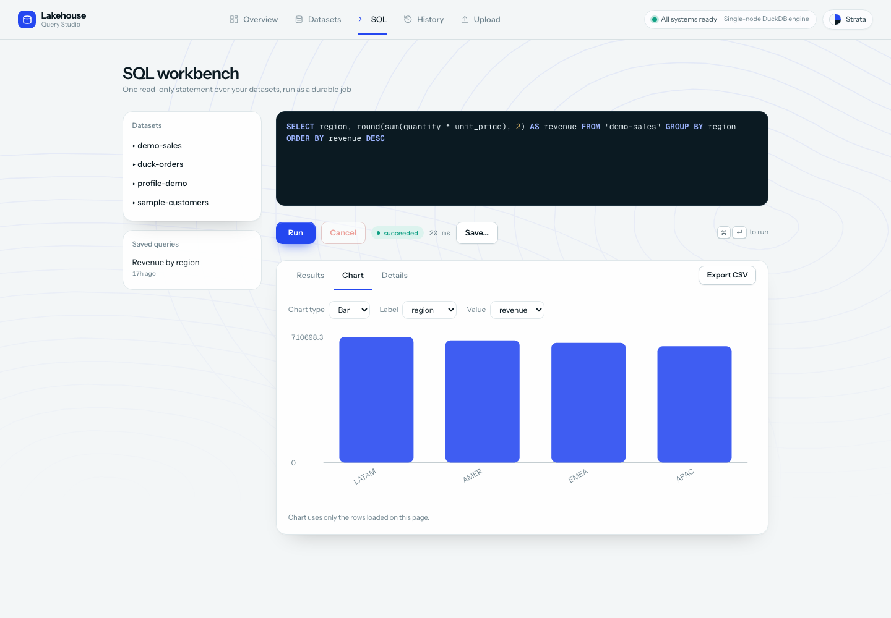

# Lakehouse Query Studio

A local-first analytical query workbench over S3-compatible object storage.
Upload CSV/JSON/JSONL or register existing Parquet, then run **bounded,
read-only SQL** against it from a web dashboard. Queries are durable
background jobs executed by **single-node DuckDB**.

> **Single-node limit.** One DuckDB node, one API, one worker. It does not
> shard, replicate or scale out, and it is not a distributed OLAP database. The
> engine sits behind `internal/query.Engine` so a measured need could justify
> another engine later.

<p align="center">
  
</p>
<p align="center">
  
</p>
<p align="center">
  
  
</p>

## Quick start

Needs **Docker** (Compose v2), **Go 1.25+ with a C/C++ compiler** (DuckDB is
linked in through cgo) and `make`.

```bash
make demo
```

`make demo` generates local credentials, builds and starts the stack, waits for
it to be healthy, loads a small deterministic sample dataset (`demo-sales`),
runs a representative SQL query, checks the answer against values computed
independently of the query engine, and prints the dashboard URL:

```
• loading the sample dataset "demo-sales" (2000 rows)...
  dataset is READY
• running a representative query:
    SELECT region, count(*) AS orders, sum(quantity * unit_price) AS revenue FROM "demo-sales" ...
   REGION   ORDERS     REVENUE
    LATAM      515   710698.30
    ...
  verified against values computed independently of the query engine
  Dashboard:  http://localhost:5173/
```

It is bounded (5-minute budget), safe to rerun (an already-loaded dataset is
reused, nothing is duplicated), and **never deletes anything**. `make down`
stops the stack and keeps your data; `docker compose down -v` also deletes the
stack's volumes, so run it only if you want that. See
[`docs/runbook.md`](docs/runbook.md) for ports, troubleshooting and what was and
was not exercised when this was validated.

## What is implemented

Each row says how to check it.

| Capability | Check it with |
|---|---|
| Register an existing Parquet prefix; browse schema and preview rows | `go test ./internal/catalog ./internal/api` |
| Upload CSV/JSON/JSONL: type inference, optional hive partitioning, versioned Parquet, leased/fenced ingestion jobs with retry | `go test ./internal/ingest` · [`docs/ingestion.md`](docs/ingestion.md) |
| One read-only SQL statement over registered datasets, parsed by DuckDB's own parser against closed allowlists, run on a sealed read-only engine; escapes, local files, extensions and arbitrary paths denied | `go test ./internal/query` · [`docs/queries.md`](docs/queries.md) |
| Durable async query jobs: submit, poll, cancel, timeout, crash recovery, no false terminal states | `go test ./test/faults` |
| Paged results, bounded CSV export, expiring result spools | `go test ./internal/api ./internal/sweeper` |
| Browser protection: Host allowlist, Origin/`Sec-Fetch-Site`, CSRF header, exact-origin CORS, optional bearer token | `go test ./internal/guard ./internal/server` · [`docs/security.md`](docs/security.md) |
| Bounded-cardinality metrics, structured logs, opt-in Prometheus + Grafana | `go test ./internal/telemetry` · `docker compose --profile ops up -d` |
| Dashboard: overview (KPIs, activity, latency, outcomes, failures, health), datasets, upload, SQL workbench with charts, history | `make web-test` · [`docs/dashboard.md`](docs/dashboard.md) |
| Reproducible benchmarks and failure-recovery tests | `make bench` · [`docs/evaluation.md`](docs/evaluation.md) |
| Real S3 client (SigV4) against a real S3-compatible server | see "Verification" below |

## Measured performance

Measured on one machine (Apple M4, 16 GiB, DuckDB v1.4.1, in-memory object
store, not isolated) with a seeded TPC-H-*like* workload (not TPC-H). Full
method, raw results and limitations: [`docs/evaluation.md`](docs/evaluation.md).
Reproduce with `make bench` (`make bench-sf1` for the larger run).

| Workload | Query p50 (single client, end to end) | Notes |
|---|---|---|
| ~600k lineitem rows (50 MiB) | 12-32 ms across the query set | Concurrency 1 to 2 workers: ~39 to ~70 queries/s |
| ~6M lineitem rows (504 MiB) | 28-1000 ms; selective scans ~700 ms | Staging is most of the time; ~1.2 queries/s at every concurrency level |

* The baseline downloads (stages) all files of the datasets a query names, and that copy dominates latency at
  the larger scale.
* **File pruning and a local stage cache** (phase 9) cut that cost. Measured over real HTTP requests at ~600k
  rows, a filter on a partition column went from 266 to 47 ms (3 of 21 files staged) and a clustered key range
  from 247 to 91 ms (1 of 3 files); at ~6M rows a clustered range staged 1 of 30 files (503.6 to 16.8 MiB).
  A repeated read served from the cache took 13-20 ms, including queries that cannot prune. Pruning only helps
  where files can be ruled out (a column present in every file saw no gain), and the first read of a dataset
  is not faster. Method, controls and caveats: [`docs/evaluation.md`](docs/evaluation.md).
* CSV to Parquet ingestion ran at roughly 40-50 MiB/s (about 760k-875k rows/s) in this setup.

## What this is not

* Not distributed, not multi-tenant, not a hosted service. There is no per-user
  authorization: the caller is a trusted operator behind a loopback-bound stack.
* Not a general SQL engine: a single `SELECT` only; no writes, DDL, `COPY`,
  `ATTACH`, extension loading or table functions other than `unnest`.
* No per-query scoped object-store credentials, no OpenTelemetry tracing, and the
  least-privilege object-store policies in `ops/minio-policies/` are not
  enforced by default (see [`docs/security.md`](docs/security.md)).
* File pruning is conservative: it skips files only for simple single-table `AND` filters on `int`/`double`/`string`/`boolean` columns. There is no result cache and no index; any other query stages every file.
* The Parquet writer supports boolean, int64, double and string, uncompressed.
* No performance claim here goes beyond the measured numbers above.

## Repository layout

| Path | Purpose |
|---|---|
| `cmd/api` | HTTP API: datasets, ingestions, queries, stats, health, metrics |
| `cmd/worker` | Ingestion pool and query pool (DuckDB), retention sweeper, `/metrics` |
| `cmd/demo` | The demo driver behind `make demo` |
| `cmd/bench` | Benchmark runner (writes JSON and Markdown) |
| `internal/` | `catalog`, `ingest`, `query`, `parquet`, `objectstore`, `guard`, `telemetry`, `sweeper`, `server`, `api`, `config`, `bench`, `demo` |
| `web/` | React + TypeScript dashboard (Vite) with a typed API client |
| `test/faults/` | End-to-end failure-recovery tests |
| `migrations/` | PostgreSQL schema migrations |
| `ops/` | Prometheus and Grafana configuration, object-store policy examples |
| `docs/` | Architecture, queries, ingestion, security, dashboard, evaluation, runbook, design contract |

## Commands

| Command | What it does |
|---|---|
| `make demo` | Start the stack, load sample data, run and verify a query |
| `make up` / `make down` | Start / stop the stack (data is kept) |
| `make verify` | Format, vet, lint, Go and web tests, typecheck, builds, bundle-secret check |
| `make test-integration` | Adds PostgreSQL-backed tests (needs `TEST_POSTGRES_URL`) |
| `make latency` | Measure queue wait, worker time and client total of a statement on the running stack |
| `make bench` / `make bench-sf1` | Benchmarks at ~600k / ~6M lineitem rows |
| `make run` / `make web` | API / Vite dev server on the host |

## Configuration

Set in the environment (Compose reads a gitignored `.env`; `make up` generates
local credentials into it and preserves any other keys you add). Secrets are
never committed, logged, or shipped to the browser. The `MINIO_*` names are
historical: they configure **any S3-compatible store**.

| Variable | Default | Purpose |
|---|---|---|
| `HTTP_ADDR` | `:8080` | API listen address |
| `POSTGRES_URL` | _(empty)_ | PostgreSQL URL (`postgres://…`) |
| `MINIO_ENDPOINT` | `localhost:9000` | S3 endpoint (`host:port`, path-style) |
| `MINIO_ACCESS_KEY` / `MINIO_SECRET_KEY` | _(empty)_ | S3 credentials (server-side only) |
| `MINIO_BUCKET` / `MINIO_USE_SSL` | `lakehouse` / `false` | Bucket; use HTTPS |
| `API_TOKEN` | _(empty)_ | Optional bearer token for non-browser clients (>= 16 chars) |
| `ALLOWED_HOSTS` / `ALLOWED_ORIGINS` | loopback + dashboard | Closed `Host` / `Origin` allowlists |
| `LOG_LEVEL` / `LOG_FORMAT` | `info` / `json` | Logging |
| `QUERY_WORKERS` | `2` | Concurrent running queries (1-16) |
| `QUERY_TIMEOUT` | `60s` | Execution budget (max 300s) |
| `QUERY_LEASE_DURATION` | `120s` | Query lease (max 600s) |
| `MAX_RESULT_ROWS` / `MAX_RESULT_BYTES` / `MAX_ROW_BYTES` | `10000` / `268435456` / `1048576` | Result bounds (byte values are integers; hard max 100000 / 1 GiB / 16 MiB) |
| `MAX_PAGE_BYTES` / `MAX_EXPORT_BYTES` / `MAX_EXPORT_ROWS` | `4194304` / `67108864` / `50000` | Paging and CSV export bounds |
| `MAX_SCAN_BYTES` | `1073741824` | Dataset bytes one query may stage (files skipped by pruning do not count) |
| `STAGE_CACHE_BYTES` | `536870912` | Local-disk cache of staged dataset objects; `0` disables |
| `QUERY_PRUNING` | `on` | `off` stops skipping files whose statistics rule them out |
| `QUEUE_DEPTH` | `100` | Combined queued query + ingestion jobs |
| `DUCKDB_THREADS` / `DUCKDB_MEMORY` | `min(4, cpus)` / `2GiB` | Per-query DuckDB budgets |
| `QUERY_TMP_DIR` | OS temp dir | Per-query scratch parent |
| `QUERY_MINIO_ACCESS_KEY` / `QUERY_MINIO_SECRET_KEY` | _(empty)_ | Optional separate credential for query reads and result spools |
| `EXPORT_TTL` / `HISTORY_RETENTION` / `STAGING_TTL` / `SWEEP_INTERVAL` | `24h` / `720h` / `24h` / `10m` | Retention and cleanup |
| `METRICS_ADDR` | `127.0.0.1:9100` | Worker `/metrics` |
| `API_HOST_PORT` / `WEB_HOST_PORT` / `S3_HOST_PORT` / `POSTGRES_HOST_PORT` | `8080` / `5173` / `8333` / `55432` | Compose host ports (all bound to `127.0.0.1`) |

## API

All routes are under the browser-request guard (mutations need
`X-Lakehouse-CSRF: 1`). Errors use one envelope
(`{ "error": { "code", "message", "details" } }`).

- `GET /healthz`, `GET /readyz` (per-dependency: `postgres`, `objectstore`), `GET /metrics`, `GET /api/v1/info`
- `POST|GET /api/v1/datasets`, `GET /api/v1/datasets/{id}[/schema|/preview]`
- `POST /api/v1/ingestions/inspect`, `POST|GET /api/v1/ingestions`, `GET /api/v1/ingestions/{id}`, `POST /api/v1/ingestions/{id}/retry`
- `POST|GET /api/v1/queries`, `GET /api/v1/queries/{id}` (`?waitMs=N` long-polls up to 5 s), `POST /api/v1/queries/{id}/cancel`, `GET /api/v1/queries/{id}/results`, `GET /api/v1/queries/{id}/export`
- `GET /api/v1/stats?window=1h|6h|24h|7d` — aggregates for the Overview, from the durable job records

## Verification

```bash
make verify            # no database or object store needed
make test-integration  # needs TEST_POSTGRES_URL (a throwaway PostgreSQL)

# Real S3-compatible server (opt-in): any store works; SeaweedFS shown.
TEST_S3_ENDPOINT=127.0.0.1:18333 TEST_S3_ACCESS_KEY=<key> TEST_S3_SECRET_KEY=<secret> \
  go test -tags integration -run S3Real ./internal/objectstore
```

[`.github/workflows/ci.yml`](.github/workflows/ci.yml) runs `make verify` and
golangci-lint on every push to `main` and every pull request.

## Documentation

[`docs/runbook.md`](docs/runbook.md) · [`docs/architecture.md`](docs/architecture.md) ·
[`docs/queries.md`](docs/queries.md) · [`docs/ingestion.md`](docs/ingestion.md) ·
[`docs/security.md`](docs/security.md) · [`docs/dashboard.md`](docs/dashboard.md) ·
[`docs/evaluation.md`](docs/evaluation.md) · [`docs/catalog.md`](docs/catalog.md) ·
[`docs/design.md`](docs/design.md) (Phase 0 contract)
