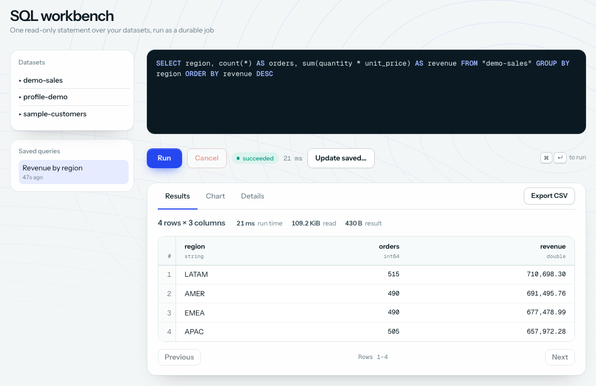
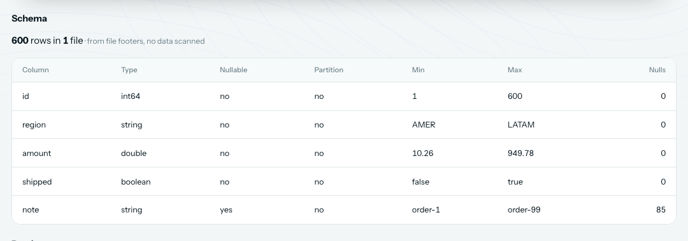

# Dashboard and SQL workbench (phase 5)

Routes (hash-based): `#/` Overview, `#/datasets` and `#/datasets/{id}`,
`#/query` SQL workbench, `#/history`, `#/upload`. The app is dependency-free
beyond React: the editor highlighting and charts are small in-repo components.

## Screens
* **Overview** – dependency status from `/readyz` (including the per-dependency
  detail the API sends with a 503), dataset total, and active/failed counts for
  queries and ingestions. Counts are computed from the most recent jobs the API
  returns (up to 100 queries), and say so. A section whose request fails shows
  its error and `—`; no number is ever invented.
* **SQL workbench** – textarea with a highlighted mirror (cosmetic only; the
  server parses and validates every statement), schema browser listing READY
  datasets with lazy column schemas and click-to-insert, Run (Ctrl/⌘+Enter),
  Cancel, status badge and elapsed time. Polls the job until terminal.
  Queued, running, cancelling, cancelled, failed, timed-out and denied states
  each have their own message. Failure text is the server's bounded summary.
* **Results** – paged table (100 rows per page, from `/results`), row × column
  counts, truncation notice, CSV export link (the browser downloads
  `/export` directly), a bar/line chart of any numeric column against any label
  column (uses the loaded page only and says how many rows it skipped), and a
  Details tab with duration, rows, bytes staged, result size, attempt and the
  bounded execution plan.
* **History** – status, duration and rows per query. **Rerun** submits the same
  text as a new job through the normal validated path (it never reuses a stored
  result or bypasses validation); the statement is passed in memory only.

## Safety
* Cell values and errors are rendered as React text; there is no
  `dangerouslySetInnerHTML`. A test renders `` as literal text.
* The app uses no `localStorage`, `sessionStorage` or IndexedDB, with one exception: `src/lib/theme.ts` remembers the chosen colour theme name (a short fixed identifier, nothing else) in `localStorage`. The bundle check allows storage in that one file only.
* `scripts/check-bundle.sh` (run by `make web-build`, hence `make verify`)
  fails if the built bundle contains credential variable names or any real
  secret value from the local `.env`, or if the source uses browser storage.
  The API never returns credentials, and the browser only ever talks to the API.

## Tests
Unit and component tests cover loading, empty, error and failure states for
every screen, cancel and long-running states, paging, chart behavior, schema
browser insertion, and the highlighter (round-trips any input).
`App.flow.test.tsx` drives the real App, client and pages against a fake API at
the `fetch` boundary through: pick a dataset → run SQL → results → chart →
export link → history → rerun, plus denial and overview.

**Real-browser coverage:** the automated flow test runs in jsdom against a fake
API. The dashboard has additionally been loaded in headless Chrome against a
live API, worker, PostgreSQL and S3-compatible store to produce the screenshots
in `docs/images/` and to check layout in light and dark themes; there is no
automated browser test suite.

## Themes

Six built-in colour themes, chosen from the picker at the right of the top bar:
Strata (the default), Mint (light) and Abyss, Ocean, Nord, Terminal (dark). The choice is
remembered in the browser (theme name only; see the storage note above). With no
saved choice the dashboard follows the OS light/dark setting. A `?theme=<id>` URL
parameter selects a theme for that view, which is how the screenshots in
`docs/images/` are produced.

Each theme in `web/src/themes.css` defines the full set of design tokens
(colours, code-editor colours, radius, focus ring), and components only read
tokens, so a new theme is one CSS block plus one entry in `web/src/lib/theme.ts`.

## Background terrain

The page background is a topographic map of nested contour rings, drawn as an SVG mask
filled with the theme accent (`web/src/assets/contours.svg`). Its interactions are
deliberately faint: the lines glow softly under the pointer, the map drifts a few
pixels against the pointer, it breathes very slowly, shifts a little as the page
scrolls, and each click sends out one faint ripple. It is decorative only: hidden from
assistive technology, switched off for reduced-motion preferences and touch screens,
and it carries no data.

## Command palette

Press Cmd/Ctrl+K (or click the key hint in the top bar) to jump to a page, open a
dataset, preview its first rows (runs `SELECT * ... LIMIT 100` through the normal
validated query path) or switch theme. Arrow keys move, Enter opens, Esc closes.

## Saved queries and the dataset profile (phase 10)

* **Saved queries.** The SQL workbench has *Save…* (becomes *Update saved…* once a saved query is
  open; the form can also *Save as new*), a *Saved queries* list under the datasets (click a name to load
  it, a second click on the × then *Delete* to remove it), and the palette lists them too.
* **Dataset profile.** The dataset page's schema table gains *Min*, *Max* and *Nulls* columns and a
  "N rows in M files" line, all from Parquet footers (no data scanned). A dash means no range is known
  for that column (see `docs/catalog.md`); datasets uploaded before statistics existed show dashes
  until they are uploaded again.

